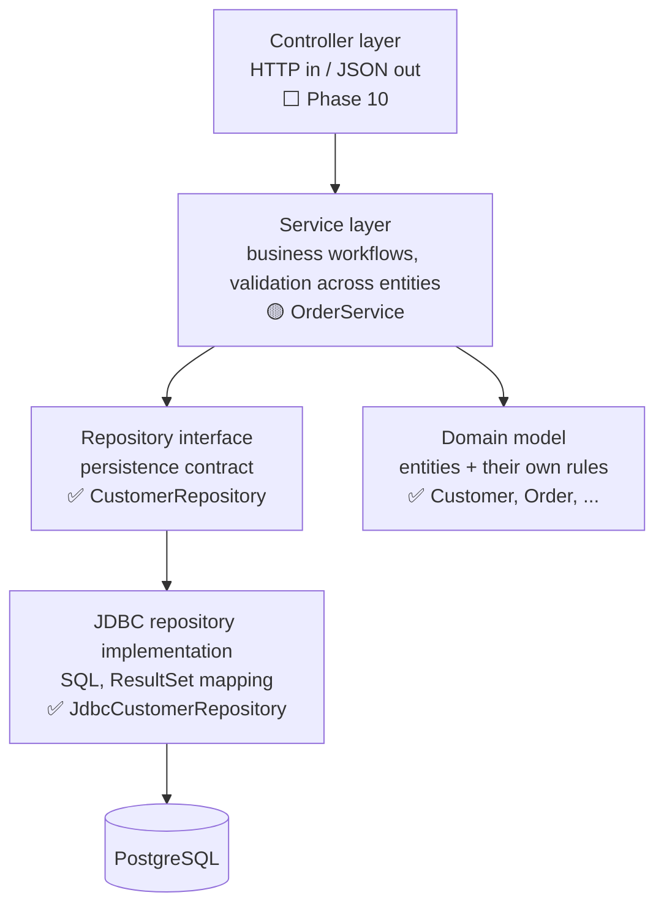
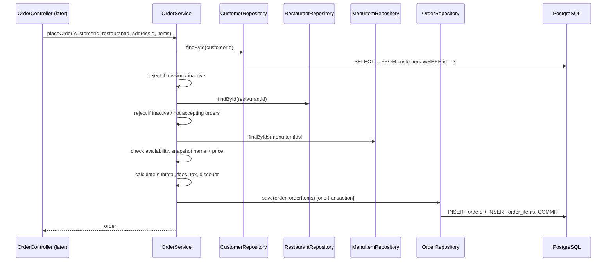
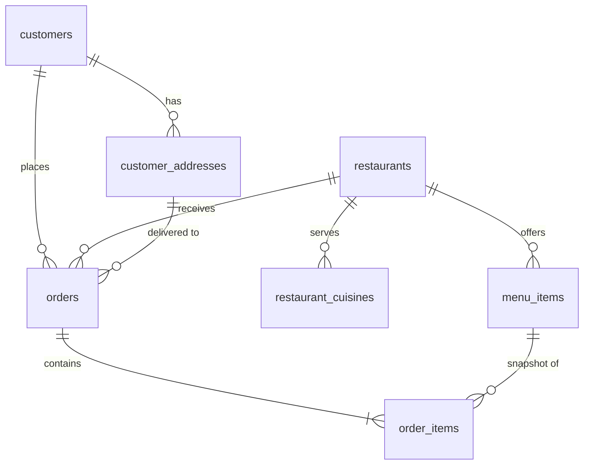

# Food Delivery System — Architecture & Design Guide

A Swiggy-like food delivery backend, built in plain Java first and migrated to Spring Boot later.
This document explains **what components exist, why they exist, how they talk to each other, and which design patterns we use (and why)**.

Read it side by side with the code. Every section points at the actual files.

**Status legend** used throughout:

| Mark | Meaning |
|---|---|
| ✅ | Implemented and tested |
| 🟡 | Started / partially implemented |
| ⬜ | Planned — not written yet |

---

## Table of Contents

1. [Tech Stack](#1-tech-stack)
2. [Architecture Overview](#2-architecture-overview)
3. [Modules (Bounded Areas)](#3-modules-bounded-areas)
4. [Layers and Their Responsibilities](#4-layers-and-their-responsibilities)
5. [Persistence with PostgreSQL](#5-persistence-with-postgresql)
6. [Database Schema](#6-database-schema)
7. [Design Patterns](#7-design-patterns)
8. [SOLID in This Codebase](#8-solid-in-this-codebase)
9. [Testing Strategy](#9-testing-strategy)
10. [Known Gaps in the Current Code](#10-known-gaps-in-the-current-code)
11. [Suggested Reading Order](#11-suggested-reading-order)
12. [Roadmap](#12-roadmap)

---

## 1. Tech Stack

| Technology | Purpose | Status |
|---|---|---|
| Java 21 | Language | ✅ |
| Maven | Build, dependency management | ✅ |
| JUnit 5 | Unit testing | ✅ |
| PostgreSQL 17 | Primary relational database | ✅ |
| PostgreSQL JDBC driver | Lets Java talk to PostgreSQL | ✅ |
| Docker / Docker Compose | Run PostgreSQL locally without installing it | ✅ `docker-compose.yml` |
| Flyway | Versioned database schema migrations | ✅ |
| HikariCP | Database connection pooling | ⬜ (after plain JDBC works) |
| Testcontainers | Real PostgreSQL in repository tests | ✅ |
| Spring Boot, Spring Data JPA, Spring Security | Framework phase | ⬜ (Phase 10) |
| Redis | Caching | ⬜ (Phase 11) |

**Why plain JDBC before JPA/Hibernate?**
JPA hides the SQL, the connections and the transactions. If you write a few repositories in plain JDBC first, you will understand exactly what Spring Data JPA automates for you later. That's what interviewers probe when they ask "what does `@Transactional` actually do?".

---

## 2. Architecture Overview

### Style: Modular Monolith

One deployable application, internally split into **modules by business capability** (customer, restaurant, order, …). We don't use microservices: they add network calls, distributed transactions and deployment overhead that we don't need yet. Clean module boundaries keep the option open to split later.

### Layered design inside each module



**The dependency rule:** arrows only point downwards. The service depends on the repository **interface**, never on `JdbcCustomerRepository` or PostgreSQL. Business logic doesn't change when the database does.

### Example flow: "Customer places an order" (target design)



---

## 3. Modules (Bounded Areas)

Base package: `com.prasad.fooddelivery`

| Module | Owns | Current files | Status |
|---|---|---|---|
| `customer` | Customers, delivery addresses | `Customer`, `Address`, `AddressLabel`, `CustomerRepository`, `AddressRepository` + JDBC implementations | ✅ models, ✅ repositories |
| `restaurant` | Restaurants, menus | `Restaurant`, `MenuItem`, `MenuCategory`, `DietaryType`, `RestaurantRepository`, `MenuItemRepository` + JDBC implementations | ✅ models, ✅ repositories |
| `order` | Orders, order line items, order lifecycle | `Order`, `OrderItem`, `OrderStatus`, `PaymentStatus`, `OrderService` | ✅ models, 🟡 service |
| `cart` | Pre-order basket | — | ⬜ |
| `payment` | Payment attempts, gateway integration, refunds | `Payment`, `PaymentMethod`, `TransactionStatus`, `PaymentGateway`, `MockPaymentGateway` | ✅ models + gateway, ⬜ repository/service |
| `delivery` | Delivery partners, assignments | `DeliveryPartner`, `Delivery`, `DeliveryStatus`, `DeliveryPartnerStatus`, `VehicleType`, `DeliveryAssignmentStrategy`, `NearestAvailablePartnerStrategy` | ✅ models + strategy, ⬜ repository/service |
| `review` | Ratings and reviews | — | ⬜ |
| `notification` | Email / SMS / push | — | ⬜ |
| `admin` | Platform management | — | ⬜ |
| `common` | Shared exceptions, utilities, DB config, geo | `DatabaseConfig`, `JdbcTimestamps`, `DataAccessException`, `GeoLocation` | 🟡 |
| `application` | `main()`, object wiring (composition root) | `FoodDeliveryApplication` | ✅ |

**Module boundary rule:** modules refer to each other **by ID** (`Order.customerId` is a `UUID`, not a `Customer` object). Then `order` doesn't need to load whole `Customer` objects, and the modules stay loosely coupled. See §6 for how this maps to foreign keys.

---

## 4. Layers and Their Responsibilities

### 4.1 Domain Model (`*/model`) ✅

**Responsibility:** represent a business concept and **protect its own rules (invariants)**. A model should never be allowed into an invalid state.

| Class | Key responsibility / rule it enforces | File |
|---|---|---|
| `Customer` | Names, email, phone, password hash required; starts inactive; `activate()` / `deactivate()` | [Customer.java](../src/main/java/com/prasad/fooddelivery/customer/model/Customer.java) |
| `Address` | City, state, postal code, label and customerId are mandatory | [Address.java](../src/main/java/com/prasad/fooddelivery/customer/model/Address.java) |
| `Restaurant` | Name, phone required; commission 0–100; deactivating also stops accepting orders; an inactive restaurant cannot start accepting orders | [Restaurant.java](../src/main/java/com/prasad/fooddelivery/restaurant/model/Restaurant.java) |
| `MenuItem` | Price must be > 0; category and dietary type mandatory; starts available | [MenuItem.java](../src/main/java/com/prasad/fooddelivery/restaurant/model/MenuItem.java) |
| `Order` | Amounts non-negative; discount ≤ order amount; `totalAmount` is **derived**, never passed in; starts `PLACED` + `PENDING`; only valid status transitions allowed | [Order.java](../src/main/java/com/prasad/fooddelivery/order/model/Order.java) |
| `OrderItem` | Snapshots item name and unit price; `totalPrice` is recalculated whenever quantity changes | [OrderItem.java](../src/main/java/com/prasad/fooddelivery/order/model/OrderItem.java) |
| `Payment` | One payment **attempt**: amount > 0, idempotency key required; `INITIATED → SUCCEEDED → REFUNDED` or `INITIATED → FAILED`; a retry is a new `Payment` | [Payment.java](../src/main/java/com/prasad/fooddelivery/payment/model/Payment.java) |
| `DeliveryPartner` | Suspended partners can't go online; can't go offline or be suspended mid-delivery; `OFFLINE ⇄ AVAILABLE ⇄ BUSY` | [DeliveryPartner.java](../src/main/java/com/prasad/fooddelivery/delivery/model/DeliveryPartner.java) |
| `Delivery` | Only the assigned partner can accept / pick up / deliver; rejection returns it to the pool; no cancellation after pickup | [Delivery.java](../src/main/java/com/prasad/fooddelivery/delivery/model/Delivery.java) |

Enums (`OrderStatus`, `PaymentStatus`, `AddressLabel`, `MenuCategory`, `DietaryType`) restrict a value to a fixed set, so code like `order.setStatus("delivrd")` can't compile.

**What does NOT belong here:** SQL, HTTP, calls to other repositories.

### 4.2 Repository (`*/repository`) 🟡 (all except Order done)

**Responsibility:** store and load domain objects. It is the **only** layer that knows about the database.

Two parts:

- **Interface** (the contract), e.g. [CustomerRepository.java](../src/main/java/com/prasad/fooddelivery/customer/repository/CustomerRepository.java):
  ```java
  Customer save(Customer customer);              // insert or update ("upsert")
  Optional<Customer> findById(UUID customerId);
  ```
  It returns `Optional` because "not found" is a normal outcome, not an error. It forces the caller to handle that case, where a `null` would be silently passed along.
- **Implementation**, e.g. [JdbcCustomerRepository.java](../src/main/java/com/prasad/fooddelivery/customer/repository/JdbcCustomerRepository.java) ✅: writes the SQL, binds parameters with `PreparedStatement`, and maps each `ResultSet` row back into a `Customer`.

**Rule:** add methods to the interface only when a service actually needs them. Every method on the interface is a method every implementation must support from then on.

| Repository | Methods | Notes |
|---|---|---|
| `CustomerRepository` ✅ | `save`, `findById` | `findByEmail` comes with registration |
| `AddressRepository` ✅ | `save`, `findById`, `findByCustomerId` | No `delete` until the order/address snapshot decision (§10) |
| `RestaurantRepository` ✅ | `save`, `findById` | Writes 2 tables in **one transaction** (restaurant + cuisines) |
| `MenuItemRepository` ✅ | `save`, `findById`, `findByRestaurantId` | `findAllByIds` comes with `placeOrder` |
| `OrderRepository` ⬜ | — | Saves an order together with its items |

### 4.3 Service (`*/service`) 🟡

**Responsibility:** run **business workflows that span multiple entities or repositories**, and decide transaction boundaries.

Example: "is the customer active, is the restaurant accepting orders, are all items available?" No single model can answer that alone, so it belongs in `OrderService`.

Current state, [OrderService.java](../src/main/java/com/prasad/fooddelivery/order/service/OrderService.java):
```java
public OrderService(CustomerRepository customerRepository) { ... }
```
It receives its dependency through the constructor (**constructor injection**) and stores it in a `final` field. It has no behaviour yet.

**Model vs service, where does a rule go?**

| Rule | Lives in | Why |
|---|---|---|
| Quantity must be > 0 | `OrderItem` | Only needs the item's own data |
| Inactive restaurant cannot accept orders | `Restaurant` | Only needs the restaurant's own state |
| Customer must be active to place an order | `OrderService` | Needs a `Customer` *and* the order workflow |
| All cart items must be from the same restaurant | `CartService` / `Cart` | Needs several items together |
| Only one default address per customer | `AddressService` + DB unique index | Needs *all* of a customer's addresses |

### 4.4 Controller (`*/controller`) ⬜ Phase 10

Translates HTTP ⇄ service calls. No business logic. Introduced with Spring Web.

### 4.5 Composition Root ([FoodDeliveryApplication.java](../src/main/java/com/prasad/fooddelivery/application/FoodDeliveryApplication.java)) ✅

Without Spring, *someone* has to create objects and pass the dependencies in. That is the composition root, the only place that knows the concrete classes:

```java
DataSource dataSource = DatabaseConfig.createDataSource();
CustomerRepository customerRepository = new JdbcCustomerRepository(dataSource);
OrderService orderService = new OrderService(customerRepository);
```

Later, Spring's IoC container does exactly this for you. Wiring by hand first makes it clear what Spring is automating.

---

## 5. Persistence with PostgreSQL

### 5.1 Components

| Component | Responsibility | Location | Status |
|---|---|---|---|
| `docker-compose.yml` | Runs PostgreSQL locally | project root | ✅ |
| `application.properties` | Local-dev DB URL, username, password; overridden by `DB_URL` / `DB_USERNAME` / `DB_PASSWORD` env vars in real environments | `src/main/resources/` | ✅ |
| `DatabaseConfig` | Builds a `javax.sql.DataSource`; runs Flyway migrations | `common/db/` | ✅ |
| `DataAccessException` | Unchecked wrapper around `SQLException`, so services never see JDBC types | `common/exception/` | ✅ |
| `JdbcTimestamps` | `Instant` ⇄ `TIMESTAMPTZ` conversion shared by all repositories | `common/db/` | ✅ |
| Flyway migrations | Versioned, repeatable schema creation | `src/main/resources/db/migration/` | ✅ V1 customers, V2 restaurants + cuisines, V3 menu_items, V4 customer_addresses |
| `JdbcXxxRepository` | SQL + row mapping for one aggregate | `<module>/repository/` | ✅ Customer, Address, Restaurant, MenuItem |
| `TransactionManager` (small, hand-written) | Begin/commit/rollback across repositories | `common/db/` | ⬜ (with `placeOrder`) |

### 5.2 Why a `DataSource` and not `DriverManager.getConnection(...)` everywhere?

`DataSource` is an interface (the same DIP idea as repositories). Start with the PostgreSQL driver's simple `DataSource`, then swap in HikariCP's **pooled** `DataSource` when needed. No repository code changes. Opening a fresh TCP connection to Postgres per query is slow, and that's the problem pooling solves.

### 5.3 Why Flyway (schema migrations)?

The schema will change many times: a new column, a new index, a new table. Flyway runs numbered SQL files in order and records which ones have been applied, so every developer, test run and server gets the identical schema. Without it you end up with "works on my DB".

### 5.4 Mapping Java ⇄ PostgreSQL types

| Java | PostgreSQL | Note |
|---|---|---|
| `UUID` | `UUID` | Native type, 16 bytes; use `setObject` / `getObject(col, UUID.class)` |
| `BigDecimal` | `NUMERIC(10,2)` | Exact decimal. **Never** `REAL`/`DOUBLE` for money |
| `String` | `VARCHAR(n)` / `TEXT` | |
| `boolean` | `BOOLEAN` | |
| `Instant` | `TIMESTAMPTZ` | Used for all created/updated times. The driver reads/writes it as `OffsetDateTime` |
| `enum` | `VARCHAR(30)` + `CHECK` constraint | Easier to evolve than a Postgres `ENUM` type |

### 5.5 Transactions, the real design challenge

Placing an order writes to `orders` **and** `order_items`. If the second insert fails, the first must be undone, which means **both must use the same `Connection`** with `autoCommit = false`.

But if each repository grabs its own connection from the `DataSource`, they can't share a transaction. Typical solutions:

1. Pass a `Connection` into repository methods (simple, but leaks JDBC into service code).
2. A small `TransactionManager` that keeps the current connection for the current thread (in a `ThreadLocal`), so repositories use whichever transaction is active.

Option 2 is essentially a hand-written version of Spring's `@Transactional`. We'll build it when we implement `placeOrder`.

---

## 6. Database Schema

Tables for the models that already exist. `customers`, `customer_addresses`, `restaurants`, `restaurant_cuisines` and `menu_items` have migrations; `orders` and `order_items` come with `OrderRepository`. (`order` is a reserved word in SQL, so the table is `orders`.)



### `customers`
| Column | Type | Constraints |
|---|---|---|
| id | UUID | PK |
| first_name, last_name | VARCHAR(100) | NOT NULL |
| email | VARCHAR(255) | NOT NULL, **UNIQUE on `LOWER(email)`** (case-insensitive) |
| phone_number | VARCHAR(20) | NOT NULL, **UNIQUE** |
| password_hash | VARCHAR(255) | NOT NULL |
| active | BOOLEAN | NOT NULL DEFAULT false |
| created_at, updated_at | TIMESTAMPTZ | NOT NULL |

### `customer_addresses`
| Column | Type | Constraints |
|---|---|---|
| id | UUID | PK |
| customer_id | UUID | FK → customers(id), indexed |
| label | VARCHAR(20) | CHECK (HOME, WORK, OTHER) |
| house_number, street, landmark | VARCHAR | nullable |
| city, state, postal_code | VARCHAR | NOT NULL |
| latitude, longitude | NUMERIC(9,6) | nullable |
| is_default | BOOLEAN | NOT NULL DEFAULT false |
| created_at, updated_at | TIMESTAMPTZ | NOT NULL |

**The "only one default address" rule** (deferred in `Address`) becomes a **partial unique index**. The database itself refuses a second default address, even if two requests race each other:
```sql
CREATE UNIQUE INDEX uq_one_default_address_per_customer
    ON customer_addresses (customer_id) WHERE is_default;
```

### `restaurants` and `restaurant_cuisines`
`restaurants`: id (PK), name, description, phone_number, email, average_rating `NUMERIC(2,1)`, total_ratings_count, pure_veg, active, accepting_orders, commission_percentage `NUMERIC(5,2)` with `CHECK (0–100)`, timestamps.

`cuisineTypes` is a `List<String>`, and a relational column can't hold a list directly. Options:
- **Separate table** `restaurant_cuisines(restaurant_id FK, cuisine VARCHAR, PK(restaurant_id, cuisine))`: normalized and easy to search ("all South Indian restaurants"). **Recommended.**
- Postgres `TEXT[]` array column: simpler, Postgres-specific, and harder to index and evolve.

### `menu_items`
id (PK), restaurant_id (FK, indexed), name, description, price `NUMERIC(10,2)` `CHECK > 0`, category, dietary_type, image_url, available, recommended, timestamps.

### `orders`
id (PK), customer_id (FK), restaurant_id (FK), delivery_address_id (FK), order_status, payment_status, subtotal, delivery_fee, tax_amount, discount_amount, total_amount (all `NUMERIC(10,2)`), special_instructions, timestamps.
Indexes: `(customer_id, created_at DESC)` for "my order history", `(restaurant_id, order_status)` for "restaurant's active orders".

### `order_items`
id (PK), order_id (FK, `ON DELETE CASCADE`), menu_item_id (FK), **item_name, unit_price** (snapshot), quantity `CHECK > 0`, total_price, special_instructions, timestamps.

> **Snapshot vs foreign key.** `menu_item_id` is a FK, so we can still link back to the dish. But we *copy* `item_name` and `unit_price` instead of joining to `menu_items` at read time. If the restaurant raises the biryani price from ₹250 to ₹300 tomorrow, yesterday's invoice must still say ₹250. This is deliberate denormalization.

> **Address on orders.** `delivery_address_id` points at a row the customer can later edit or delete. Real systems usually **snapshot the address onto the order** too, for the same reason as the item price. Decide this before writing the `orders` migration.

---

## 7. Design Patterns

Rule: **a pattern is used only when there's a concrete problem it solves.** Each row says what that problem is.

### 7.1 Already in the code ✅

| Pattern / technique | Where | Problem it solves |
|---|---|---|
| **Encapsulation + invariants in constructors** | All models, e.g. `MenuItem` price check | Invalid objects can't exist, so services don't need to re-check everything |
| **Derived state** | `Order.totalAmount`, `OrderItem.totalPrice` | Callers can't pass in a total that doesn't match its parts |
| **Snapshot** | `OrderItem.itemName`, `unitPrice` | Historical orders don't change when the menu changes |
| **Defensive copy** | `Restaurant` constructor and `getCuisineTypes()` (`List.copyOf`) | Outside code can't change the restaurant's internal list |
| **Reference by ID** | `Order.customerId`, `MenuItem.restaurantId` | Loose coupling between modules; maps cleanly to FKs |
| **Repository** | `CustomerRepository` | Hides persistence details from business logic |
| **Dependency Inversion + constructor injection** | `OrderService(CustomerRepository)`, `JdbcCustomerRepository(DataSource)` | Swap a JDBC implementation for a fake in tests without touching the service |
| **Reconstitution factory** | `restore(...)` on all six models | Public constructors create *new* entities (new UUID, status `PLACED`, `now()` timestamps). `restore` rebuilds an *existing* one exactly as stored |
| **Data Mapper / RowMapper** | `JdbcCustomerRepository.mapRow` | Converts a `ResultSet` row into a domain object without putting SQL in the model |
| **Upsert** | `INSERT … ON CONFLICT (id) DO UPDATE` in `JdbcCustomerRepository` | One `save()` for both new and existing customers; `created_at` is never overwritten |
| **State transition table** | `OrderStatus.allowedNextStatuses()`, enforced in `Order.updateOrderStatus` | Illegal moves like `DELIVERED → PLACED` or `PREPARING → CANCELLED` throw `IllegalStateException` |
| **Composition root** | `FoodDeliveryApplication` | Only one place knows the concrete classes |
| **Strategy** | `DeliveryAssignmentStrategy` → `NearestAvailablePartnerStrategy` | "Who gets this delivery?" has several valid rules (nearest, least busy, best rated); a new rule is a new class, not an `if/else` in the service |
| **Adapter-ready gateway interface** | `PaymentGateway` → `MockPaymentGateway` | Payment code never depends on a specific provider; Razorpay/Stripe become new implementations |
| **Idempotency key** | `Payment.idempotencyKey`, `MockPaymentGateway` | A retried "Pay" (double click, timeout) returns the original result instead of charging twice |
| **Value object (record)** | `GeoLocation`, `ChargeRequest`, `RefundRequest`, `GatewayResult` | Immutable, compared by value, validated once in the compact constructor |
| **Separate status per concept** | `order.PaymentStatus` vs `payment.TransactionStatus` | An order has one "is it paid?" answer, but may have several payment attempts |

### 7.2 Planned, with the trigger that will introduce each ⬜

| Pattern | Where | The concrete problem that will justify it |
|---|---|---|
| **Unit of Work / transaction manager** | `common/db` | `orders` + `order_items` must be saved atomically (§5.5) |
| **State pattern (full)** | `Order` | Only if per-status *behaviour* grows (e.g. different cancellation fees per status). The transition table is enough for now |
| **Strategy** | Pricing, delivery fee, tax, discount | Several interchangeable algorithms (flat fee vs distance-based fee; nearest vs least-busy partner) without `if/else` chains |
| **Factory** | Payment gateway selection | Choose a gateway per `PaymentMethod` once there is more than one real gateway |
| **Adapter** | `PaymentGateway` over a real provider SDK | Our interface stays stable even if the provider's API is different |
| **Builder** | `Order` (8 constructor args, likely more) | Long same-typed argument lists (`BigDecimal, BigDecimal, BigDecimal…`) are easy to mix up |
| **Observer / domain events** | Order status changes → notifications | `OrderService` shouldn't have to know about SMS, email and push providers |
| **Idempotency key** | Order placement | A retried "Place order" must not create two orders |
| **Optimistic locking** (`version` column) | Orders, menu items | Two concurrent updates must not silently overwrite each other |

---

## 8. SOLID in This Codebase

| Principle | Concrete example here |
|---|---|
| **S**ingle Responsibility | `OrderItem` knows its own pricing. It does **not** know how to save itself (that's the repository) or whether the customer is active (that's the service) |
| **O**pen/Closed | (planned) A new `DeliveryFeeStrategy` implementation adds surge pricing without editing `OrderService` |
| **L**iskov Substitution | Any `CustomerRepository` (JDBC, fake in tests) must behave the same: e.g. `findById` returns `Optional.empty()` for unknown IDs. It never throws, and never returns `null` |
| **I**nterface Segregation | `CustomerRepository` has only the methods services actually call, not a generic 20-method CRUD interface |
| **D**ependency Inversion | `OrderService` → `CustomerRepository` (abstraction) ← `JdbcCustomerRepository` (detail) |

---

## 9. Testing Strategy

| Level | What | Tooling | Speed |
|---|---|---|---|
| Model unit tests ✅ | Creation, invalid input, rules, state changes | JUnit 5 | ms |
| Service unit tests ⬜ | Workflows and rule violations | JUnit 5 + **fake repositories** (simple `Map`-backed classes in `src/test`) | ms |
| Repository integration tests ✅ (Customer, Address, Restaurant, MenuItem) | SQL is correct, mapping round-trips, constraints fire | JUnit 5 + **Testcontainers** (real PostgreSQL in Docker) | seconds |
| API tests ⬜ | HTTP contract | Spring Boot test (Phase 10) | seconds |

**Why keep in-memory fakes even though production uses PostgreSQL?** Service tests should check *business logic*, not SQL. A fake `CustomerRepository` makes them fast and focused. And it's the clearest demonstration of DIP: the same `OrderService` runs against the fake in tests and against PostgreSQL in production.

**Current result:** `mvn clean test`: 160 tests, 0 failures. 128 model/gateway/strategy tests + 32 repository tests (Customer 8, Address 8, Restaurant 9, MenuItem 7). Docker must be running for the repository tests.

All repository tests share **one** PostgreSQL container ([PostgresTestDatabase.java](../src/test/java/com/prasad/fooddelivery/common/db/PostgresTestDatabase.java)), and each test empties the tables first, so tests never depend on each other.

---

## 10. Known Gaps in the Current Code

### Resolved
| # | Gap | Fix |
|---|---|---|
| 1 | Objects couldn't be loaded back from the database (constructors always generate a new UUID, `now()` timestamps, status `PLACED`) | `restore(...)` factory on `Customer`, `Address`, `Restaurant`, `MenuItem`, `Order`, `OrderItem` |
| 2 | `Customer` had no `getPasswordHash()` | Added |
| 3 | `Order.updateOrderStatus` accepted any transition | `OrderStatus.allowedNextStatuses()`; invalid moves throw `IllegalStateException` |
| 4 | `Customer` and `Restaurant` validated nothing | `Customer`: names, email (contains `@`), phone, password hash. `Restaurant`: name, phone, commission 0–100 |
| 5 | `Restaurant.pureVeg` was always `false` | New constructor parameter |
| 6 | `LocalDateTime` has no time zone | All models use `Instant`, stored as `TIMESTAMPTZ` |
| 9 | Two README files | Merged into `README.md` |

**Order lifecycle now enforced:**
```
PLACED → CONFIRMED → PREPARING → READY_FOR_PICKUP → OUT_FOR_DELIVERY → DELIVERED
   └───────┴──→ CANCELLED   (only before PREPARING)
```

### Still open
7. **`Instant.now()` inside models** makes time hard to test. → Inject a `java.time.Clock` when a test needs to control time.
8. **Delivery address on the order** is a reference, not a snapshot (§6). Decide before writing the `orders` migration.
10. **`restore(...)` trusts its input.** It only checks the id (plus statuses for `Order`), because the data comes from our own database, which already enforces `NOT NULL`/`CHECK` constraints. If `restore` is ever fed untrusted input, it must validate fully.
11. **Email check is minimal** (`contains("@")`). Real validation, normalization (lower-casing) and verification emails belong in `CustomerService` registration.
12. ~~`PaymentStatus` has no transition rules~~ → resolved: `PENDING → SUCCESS/FAILED`, `FAILED → SUCCESS` (successful retry), `SUCCESS → REFUNDED`.
14. **`Restaurant` has no location.** A `Delivery` needs a pickup `GeoLocation`, and nearest-partner assignment measures distance from it. → Add an address/location to `Restaurant` (and its table) before `DeliveryAssignmentService`.
15. **`Address` latitude/longitude are optional `BigDecimal`s**, while `Delivery` needs a `GeoLocation`. → Decide whether coordinates become mandatory (e.g. resolved by a geocoding API when the address is saved).
16. **Order ⇄ delivery ⇄ payment status coordination is not wired yet.** E.g. delivery `PICKED_UP` → order `OUT_FOR_DELIVERY`; payment `SUCCEEDED` → order payment `SUCCESS`. That is the job of `DeliveryService` / `PaymentService`, which need `OrderRepository` first.
17. **Rejected partners aren't remembered.** After a rejection the same partner could be offered the delivery again. → `DeliveryAssignmentService` should exclude partners who already rejected it.
13. **No transactions across repositories yet.** Each repository call uses its own connection with auto-commit. That's fine for single-row writes, but not for order + order items (§5.5).

---

## 11. Suggested Reading Order

1. Enums: `OrderStatus`, `PaymentStatus`, `AddressLabel`, `MenuCategory`, `DietaryType`. They're small and define the vocabulary.
2. `MenuItem` → `MenuItemTest`: the cleanest example of constructor validation.
3. `Order` → `OrderTest`: derived totals, the discount rule, initial state.
4. `OrderItem` → `OrderItemTest`: the snapshot idea, recalculating on change.
5. `Restaurant` → `RestaurantTest`: state rules between `active` and `acceptingOrders`, defensive copy.
6. `Customer`, `Address`: notice the two ways to get an object, `new` (a brand-new entity) vs `restore(...)` (an existing one).
7. `CustomerRepository` → `JdbcCustomerRepository` → `JdbcCustomerRepositoryTest`: the contract, the SQL behind it, and the proof it works on real PostgreSQL.
8. `V1__create_customers.sql`, `DatabaseConfig`: how the schema is created and where connections come from.
9. `FoodDeliveryApplication` → `OrderService`: the composition root wiring the concrete classes behind the interfaces.

For each class, ask yourself:
- What rule does this class protect?
- What would break if a field were public?
- Which of its rules need *other* objects, and therefore belong in a service?

---

## 12. Roadmap

| Phase | Scope | Status |
|---|---|---|
| 1 | Core domain models + tests | ✅ |
| 2 | PostgreSQL setup ✅; Customer, Address, Restaurant, MenuItem repositories ✅; next: Order repository (needs transaction + address-snapshot decisions) | 🟡 |
| 3 | Services: Customer, Restaurant, Menu, Address, Order (with fake repositories in tests) | 🟡 skeleton |
| 4 | Cart | ⬜ |
| 5 | Order workflow, pricing strategies, status transitions, transactions | ⬜ |
| 6 | Payment: model ✅, gateway interface + mock ✅, idempotency ✅; next: `payments` table, repository, `PaymentService` (after `OrderRepository`) | 🟡 |
| 7 | Delivery: partner + delivery models ✅, status transitions ✅, assignment strategy ✅; next: tables, repositories, `DeliveryAssignmentService` | 🟡 |
| 8 | Reviews, notifications (observer) | ⬜ |
| 9 | Admin: management, commissions, analytics | ⬜ |
| 10 | Spring Boot: DI, REST, DTOs, validation, Spring Data JPA, Security/JWT, OpenAPI | ⬜ |
| 11 | Production: HikariCP tuning, Redis, pagination, logging, monitoring, concurrency, rate limiting | ⬜ |
